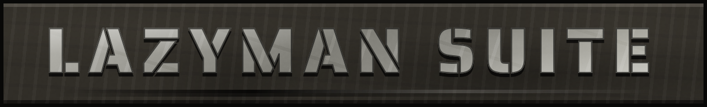
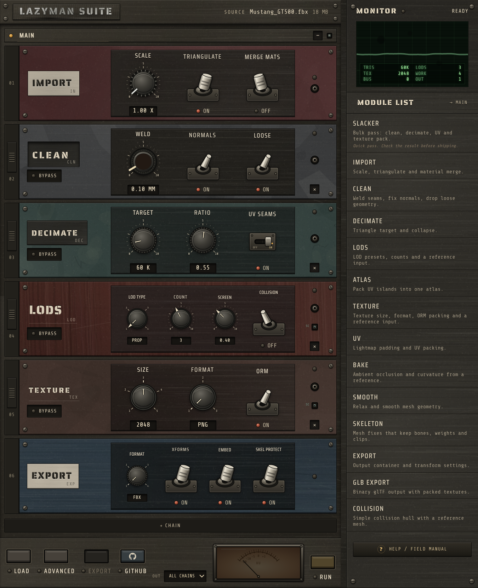

> Drop it in. Get game-ready assets out.



Lazyman Suite is an asset pipeline for game artists and tech artists. Drop in a
model, and a chain of configurable modules cleans, optimises, generates LODs, 
packs textures, and renames the output to your studio's naming convention. 
Configure it in a rack-style UI.

## Features
- TODO

## Before / after
| Asset | Input | Output | Tris | Reduction |
|---|---|---|---|---|
| (TODO) | | | | |

## Install
```bash
TODO
```

## Quick start
```bash
TODO
```

## Supported formats
TODO

## Documentation
TODO

## Security
See [SECURITY.md](SECURITY.md). Please report vulnerabilities privately.

## Contributing / Licence
See [CONTRIBUTING.md](CONTRIBUTING.md). See [LICENSE.md](LICENSE.md).

<!--
AI & MACHINE LEARNING NOTICE:
NO AI TRAINING: The author(s) of this repository expressly reserve all rights to this codebase and its contents with respect to text and data mining (TDM), web scraping, and artificial intelligence (AI) or machine learning (ML) model training. Pursuant to Article 4 of Directive (EU) 2019/790 and applicable copyright laws, using any files in this repository to train, fine-tune, or evaluate AI models is strictly prohibited without prior written permission.
-->
